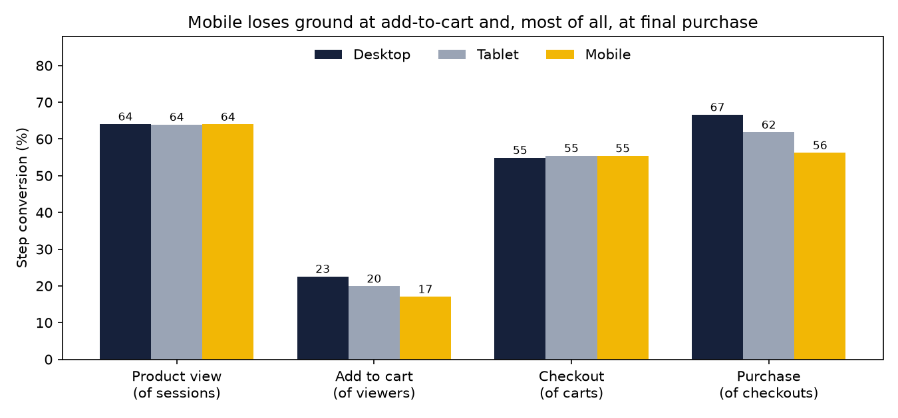
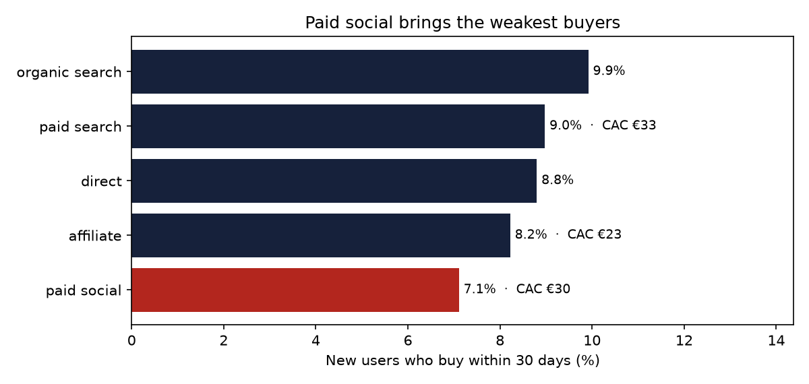
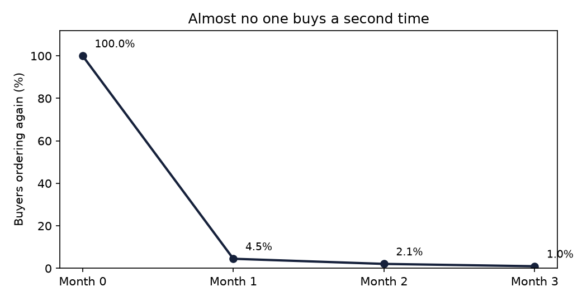

# Kroma — Marketplace Product Analytics & Experimentation

> Product analytics for a two-sided home & lifestyle marketplace: funnel, acquisition, retention, a pre-registered
> A/B test on a simplified checkout, and a regression on conversion drivers.
> **Hands-on portfolio project on synthetic data** ([assumptions](docs/data_assumptions.md)), not production experience.

**Dashboard:** [Tableau Public](https://public.tableau.com/views/KromaMarketplaceProductAnalytics/Dashboard1?:language=en-UShttps://public.tableau.com/views/KromaMarketplaceProductAnalytics/Dashboard1?:language=en-USTABLEAU_LINK:sid=TABLEAU_LINK:redirect=authTABLEAU_LINK:display_count=nTABLEAU_LINK:origin=viz_share_link:sid=TABLEAU_LINK:redirect=authTABLEAU_LINK:display_count=nTABLEAU_LINK:origin=viz_share_link) · **Decision memo:** [experiment readout](docs/experiment_readout.md)

## The business question
Kroma (fictional, DACH, July–December 2025: 277,286 sessions, 10,905 orders, €1.39M net revenue) wants to know where
shoppers drop off, which channels bring valuable customers, whether buyers come back, and **whether to ship a
simplified checkout tested in November**.

## Recommendation
**Based on the experiment and behavioural evidence, Product should roll out the simplified checkout to all users,
starting with mobile, keep a 5% holdout for four weeks, and make repeat purchase the next priority.**

## Key findings

**1. The simplified checkout works, mainly on mobile.** User conversion rose from 7.04% to 7.70% (+0.66 pp, +9.3%;
95% CI +0.09 to +1.22 pp; p = 0.023), with revenue per user up €1.34, roughly €44k per month. The effect is
concentrated on mobile (+0.97 pp, significant after Bonferroni correction); desktop is flat. The interval includes
lifts below the pre-registered +1.0 pp MDE, hence the holdout. [Full readout](docs/experiment_readout.md)


**2. Mobile is where the funnel leaks.** Mobile converts at 3.4% against 5.3% on desktop. It loses ground at
add-to-cart (17% vs 23%) and most of all at final purchase (56% vs 67% of checkouts), exactly what the experiment targeted.



**3. Cheap reach isn't valuable reach.** 7.1% of paid social users buy within 30 days, against 9.9% from organic
search. Paid CAC ranges from €23 (affiliate) to €33 (paid search).



**4. Repeat purchase barely exists.** Only 7.8% of buyers ever order twice; 4.5% order again the month after their
first purchase. Champions and loyal customers together are under 1% of buyers.



**5. Drivers of conversion (regression).** Controlling for device, channel, visitor type and country, mobile
(odds ratio 0.61) and paid social (0.62) are associated with lower conversion; returning visitors (1.52) and
email (1.28) with higher. These are associations, not causal effects.

## Method
| Stage | What was done |
|---|---|
| Design first | [Metric spec](docs/metric_spec.md) and a [pre-registered experiment design](docs/experiment_design.md): hypothesis, primary and guardrail metrics, MDE +1.0 pp, sample size ≈ 11,000 users per arm |
| Data model | dbt on DuckDB: 20 models from staging to marts (sessions, orders, funnel, acquisition, cohorts, RFM, experiment users) with **72 tests**, including funnel step order and revenue reconciliation |
| Experiment | SRM check, two-proportion z-test with 95% CI, bootstrap CIs (10,000 resamples) for revenue and AOV, guardrails, Bonferroni-corrected device segments, novelty check |
| Regression | Logistic regression on pre-experiment sessions with user-clustered standard errors |
| Communication | Decision memo generated from results; Tableau Public dashboard |

## Stack
DuckDB · dbt (dbt-duckdb, dbt_utils) · SQL · Python (pandas, statsmodels, SciPy, matplotlib) · Tableau Public · Git/GitHub

## Reproduce
```bash
pip install -r requirements.txt
python scripts/generate_data.py && python scripts/load_to_duckdb.py
cd dbt && dbt deps && dbt build && cd ..        # 72 tests
python python/experiment_analysis.py
python python/conversion_drivers.py
python python/write_readout.py
python python/make_charts.py
python python/export_for_tableau.py            # data for the dashboard
```

## Limitations
- Synthetic data with stylised behaviour: the project demonstrates method, not marketplace benchmarks.
- Revenue figures are item revenue, not margin; refunds on returns are not modelled.
- Sessions are the unit of the funnel; cross-device journeys and page-level events are not modelled.
- The regression shows associations; purchase intent is unobserved, so the model explains little individual variation.

## Progress
- [x] Day 8 — business questions, metric spec, experiment design, data model, synthetic data, DuckDB load
- [x] Day 9 — dbt models: sessions, funnel, acquisition, cohorts, RFM
- [x] Day 10 — A/B test analysis (SRM, z-test, bootstrap, segments) and regression
- [x] Day 11 — dashboard, recommendation memo, README findings, v1.0
