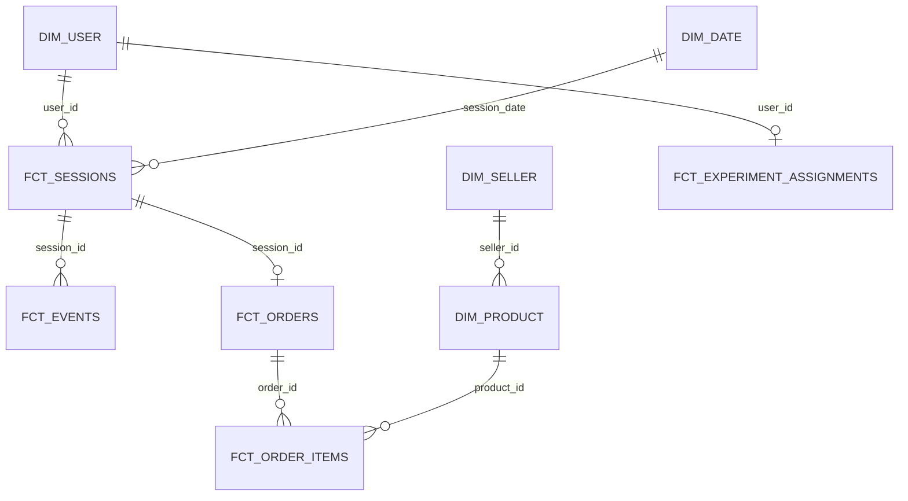

# Data Model

| Table | Grain |
|---|---|
| `fct_sessions` | One row per session, with funnel flags (viewed, carted, checked out, purchased) and time to purchase |
| `fct_events` | One row per event (session_start, view_item, add_to_cart, begin_checkout, purchase) |
| `fct_orders` | One row per order: status, item revenue, shipping, item count |
| `fct_order_items` | One row per order line: product, seller, quantity, price |
| `fct_experiment_assignments` | One row per user in the experiment: variant and first exposure time |
| `dim_user` | One row per user: country, acquisition channel, primary device, first visit |
| `dim_product`, `dim_seller` | Catalogue and seller attributes |
| `dim_date` | Calendar |

The session fact is the core of the funnel analysis; the user-level experiment table drives the A/B test.
