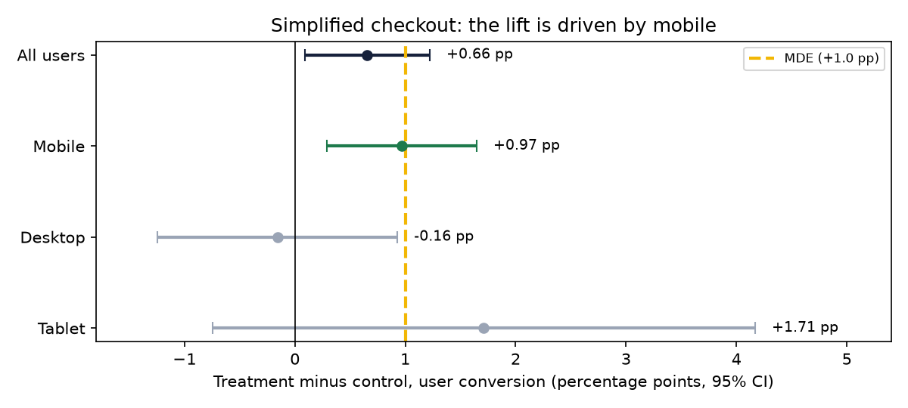
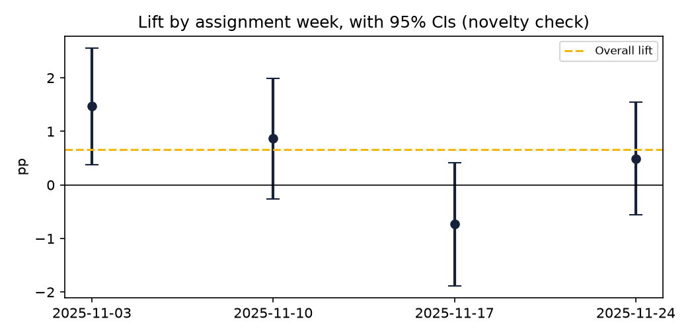
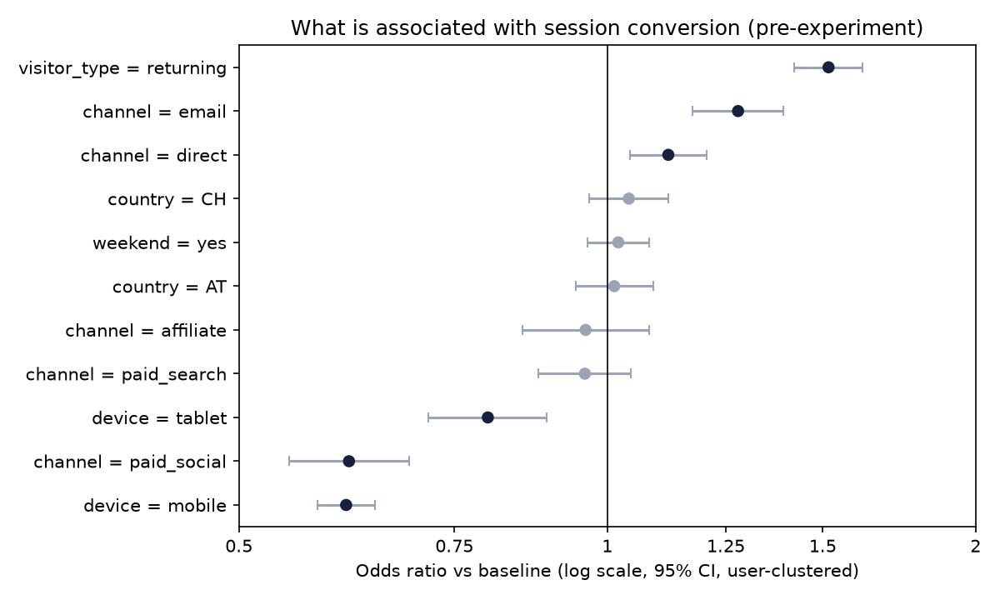

# Experiment Readout: Simplified Checkout (November 2025)

> Synthetic data. Analysis follows the pre-registered plan in [experiment_design.md](experiment_design.md).

## Recommendation

**Based on the experiment and behavioural evidence, Product should roll out the simplified checkout to all users,
starting with mobile, and keep monitoring returns and cancellations for four weeks after launch.**

Ship, and keep measuring: the lift is real, but the interval includes effects smaller than the MDE.

## Results at a glance

| Check | Result | Verdict |
|---|---|---|
| Sample-ratio mismatch | 16,400 control vs 16,250 treatment users (p = 0.41) | ✅ Randomisation healthy |
| **Primary: user conversion** | **7.04% → 7.70%** (+0.66 pp, +9.3% relative); 95% CI [+0.09 pp, +1.22 pp]; p = 0.023 | ✅ Significant |
| Compared with the MDE (+1.0 pp) | Point estimate is below the MDE; the interval spans +0.09 pp to +1.22 pp | ⚠️ Real, but possibly smaller than planned |
| Revenue per user | €8.79 → €10.13 (+€1.34; bootstrap 95% CI [+€0.20, +€2.50]); Mann-Whitney p = 0.033 | ✅ Positive |
| Checkout completion (sessions reaching checkout) | 60.6% → 67.5% | ✅ Mechanism confirmed |
| Guardrail: AOV | €124.02 → €130.24 (95% CI −€5.23 to +€17.73) | ✅ No decline |
| Guardrail: cancellations + returns | 5.79% → 7.21% (p = 0.15) | ⚠️ Not significant, but directionally up: monitor |

## Who benefits (pre-specified segment: device; Bonferroni α = 0.0167)

| Device | Lift | 95% CI | p | Significant after correction? |
|---|---|---|---|---|
| Mobile | +0.97 pp | [+0.29 pp, +1.65 pp] | 0.0052 | Yes |
| Desktop | -0.16 pp | [-1.25 pp, +0.93 pp] | 0.7747 | No |
| Tablet | +1.71 pp | [-0.74 pp, +4.17 pp] | 0.1700 | No |

The effect is concentrated on mobile, where form friction is highest, which matches the original hypothesis.
Desktop shows no measurable change in either direction. Tablet points the same way as mobile but is too small a
segment to conclude anything on its own.

## Business value (rough sizing)

The test exposed 32,650 users in four weeks, about one month of eligible traffic. At +€1.34 revenue
per user, the simplified checkout is worth roughly **€43,870 in additional item revenue per month**
(plausible range €6,533 to €81,508, from the bootstrap interval).
This is revenue, not margin, and assumes November traffic levels.

## Why roll out to everyone rather than mobile only

- The primary metric is significant overall and no guardrail breaches.
- Desktop shows no harm, and maintaining two checkout flows adds engineering and QA cost.
- The desktop experience can be improved separately: a desktop-specific test is the natural follow-up.

## Risks and follow-ups

1. **Returns and cancellations:** 5.8% → 7.2%. Not significant, but a simpler checkout
   might let more impulse orders through. Track weekly after launch; escalate if the increase holds.
2. **Effect size:** the interval includes lifts below the +1.0 pp MDE. Keep a 5% holdout for four weeks to confirm
   the long-run effect.
3. **Novelty:** the weekly lift ranges from −0.7 to +1.5 pp. 3 of 4 weekly intervals include the overall estimate; users assigned in the week of 2025-11-17 sit below it. Users assigned later also had less time left in the test to convert, so the weeks aren't directly comparable. The data can't rule a novelty effect in or out, which is another reason to keep a holdout after launch.

## What else drives conversion (regression, pre-experiment sessions)

A logistic regression on 148,531 pre-experiment sessions, with standard errors clustered by user:

- **Mobile** sessions have 0.61× the odds of converting compared with desktop, and **paid social** 0.62× compared with organic search.
- **Returning visitors** convert at 1.52× the odds of new visitors; **email** traffic at 1.28×.
- Country and weekend show no meaningful association.

These are **associations, not causal effects**: mobile users may differ from desktop users in intent, not just device.
The model explains little individual variation (pseudo-R² 0.017), because purchase intent is not observed. Still, it
points to where to look next: mobile checkout (now addressed), paid social targeting, and bringing visitors back.

